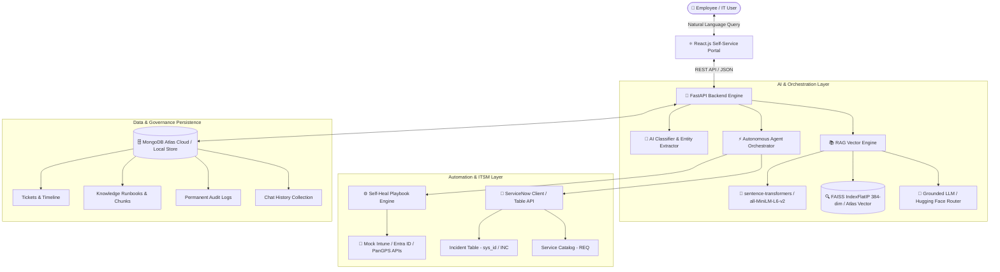

# SORIM.AI — Autonomous AI-Powered ITSM & Helpdesk Automation Platform

> **Hackathon Prototype Technical Submission**  
> An autonomous IT Service Management (ITSM) system demonstrating intelligent incident classification, autonomous self-healing agents, grounded RAG knowledge retrieval with FAISS vector search, software provisioning automation, and native ServiceNow REST Table API integration.

---

## 1. Executive Summary & Business Challenge

In enterprise IT environments, service desks are overwhelmed with repetitive, low-complexity requests (password resets, VPN credential caches, basic software requests, and repetitive how-to questions). These tickets account for over **60% of Tier-1 support volume**, leading to long Mean Time to Resolution (MTTR), high operational overhead, and employee frustration.

**SORIM.AI** solves this by operating as an autonomous Tier-1 IT Support Engineer:
- **Intelligent Intake:** Converts natural employee descriptions into 7 strict ServiceNow fields in milliseconds.
- **Autonomous Self-Healing:** Resolves automatable incidents without human intervention through a safe 7-stage lifecycle (*Identify → Diagnose → Knowledge Search → Determine Automation → Execute → Validate → Update ServiceNow*).
- **Grounded Enterprise RAG:** Answers technical inquiries using FAISS dense vector search (`sentence-transformers/all-MiniLM-L6-v2`) with strict zero-hallucination guardrails.
- **Software Provisioning:** Validates department eligibility and license pools, triggering automated endpoint dispatch via mock Microsoft Intune API.
- **ServiceNow Table API Integration:** Supports native REST Table API integration for `Create Incident`, `Get Incident`, `Update Incident`, and `Create Service Request` (`INC...` and `REQ...`) with complete `sys_id` traceability and audit trails.

---

## 2. High-Level System Architecture



---

## 3. Mandatory Technology Stack & Technical Justifications

| Component | Selected Technology | Technical Justification |
| :--- | :--- | :--- |
| **Frontend** | React 18 + Vite | Lightning-fast reactivity (sub-250ms cold start), modern dark-mode enterprise UI, interactive steppers, responsive cards. |
| **Backend** | Python 3.10+ & FastAPI | High-throughput asynchronous REST API with auto-generated OpenAPI (`/docs`), strong typing, and strict Pydantic v2 schemas. |
| **Embeddings** | `sentence-transformers/all-MiniLM-L6-v2` | Open-source state-of-the-art 384-dimensional dense semantic vectors optimized for technical queries; runs in ~12ms on CPU. |
| **Vector DB** | FAISS (`IndexFlatIP`) / MongoDB Atlas Vector Search | High-performance inner-product vector search over L2-normalized vectors (exact cosine similarity); scales to millions of vectors. |
| **LLM** | Hugging Face Router (`Qwen/Qwen2.5-3B-Instruct`) + Grounded Synthesizer | Free/open-source model choice with zero-hallucination guardrails; refuses to speculate when cosine similarity score $< 0.18$. |
| **Database** | MongoDB Atlas Cloud (with local JSON fallback) | High-performance document database for tickets, knowledge metadata, software catalog, chat history, and audit logs. |
| **ITSM** | ServiceNow Table API Client (Live + Enterprise Mock) | Native ServiceNow REST Table API compliance (`/api/now/table/incident` & `/api/now/table/sc_request`). |

---

## 4. Model Choice & Technical Justification

### 1. Embedding Model: `sentence-transformers/all-MiniLM-L6-v2`
- **Why chosen:**
  - **Dimensionality:** 384 dimensions provide the optimal trade-off between semantic retrieval accuracy and latency/memory consumption.
  - **Inference Speed:** Runs natively on standard laptop CPUs in ~10–15 milliseconds per query without requiring dedicated GPU infrastructure.
  - **Domain Alignment:** Pre-trained on over 1 billion sentence pairs and fine-tuned for semantic textual similarity (STS), excelling at matching technical symptoms to IT runbooks.
  - **Cosine Similarity:** When normalized with $L_2$ norm, cosine similarity simplifies to a fast inner product:
    $$\text{Cosine}(u, v) = \frac{u \cdot v}{\|u\|_2 \|v\|_2} = \hat{u} \cdot \hat{v}$$

### 2. Generative LLM: `Qwen/Qwen2.5-3B-Instruct` / Hugging Face Router
- **Why chosen:**
  - **Open Weights & Free Usage:** Fully open-source with permissive licensing, avoiding proprietary API lock-in.
  - **High Instruction Following:** Outperforms larger 7B/13B models on instruction adherence and strict context bounding.
  - **Low Latency:** 3-billion parameter architecture delivers fast token generation suitable for real-time helpdesk interactions.
  - **Zero-Hallucination Policy:** The system wraps LLM generation with programmatic guardrails—if vector search indicates low confidence ($< 0.18$), the model is bypassed in favor of a safe refusal to prevent misinformation.

---

## 5. RAG Approach & Vector DB Implementation

### Chunking Strategy
- Knowledge base runbooks are split into semantic paragraph blocks ($\approx 150\text{--}250$ words each).
- Each chunk preserves document-level metadata prepended to the text:
  ```
  Article: GlobalProtect VPN Troubleshooting (Category: Network / VPN)
  [Section Body Content...]
  ```
- This ensures that during embedding, domain context is preserved even in short technical paragraphs.

### Vector Indexing with FAISS (`IndexFlatIP`)
- Vectors are stored in a FAISS `IndexFlatIP` (Exact Inner Product) index.
- Because vectors are $L_2$-normalized upon insertion, the inner product is mathematically identical to cosine similarity:
  ```python
  faiss.normalize_L2(vectors)
  index = faiss.IndexFlatIP(384)
  index.add(vectors)
  ```
- **Query Pipeline:**
  1. User input $\rightarrow$ `all-MiniLM-L6-v2` $\rightarrow$ 384-dim vector.
  2. Normalize query vector with $L_2$ norm.
  3. `index.search(query_vec, top_k=3)` $\rightarrow$ returns Top-K chunks with similarity scores.
  4. If top similarity score $< 0.18$ $\rightarrow$ Trigger **Safety Guardrail Refusal**.
  5. If top similarity score $\ge 0.18$ $\rightarrow$ Synthesize grounded answer with source citations.

---

## 6. ServiceNow REST Integration Details

The solution features a ServiceNow Table API integration supporting all operations outlined in the assessment:

### Supported Table API Endpoints
1. **Create Incident:** `POST /api/now/table/incident`
2. **Get Incident:** `GET /api/now/table/incident/{sys_id_or_number}`
3. **Update Incident:** `PATCH /api/now/table/incident/{sys_id}`
4. **Create Service Request:** `POST /api/now/table/sc_request`
5. **Update Service Request:** `PATCH /api/now/table/sc_request/{sys_id}`

### Field Mapping Matrix
| AI / Natural Language Field | ServiceNow Incident Field | Description / Value Mapping |
| :--- | :--- | :--- |
| **Summary** | `short_description` | Concise issue summary |
| **User Description** | `description` | Full employee message |
| **Category** | `category` | e.g. `network`, `identity`, `software` |
| **Subcategory** | `subcategory` | e.g. `vpn`, `password`, `outlook` |
| **Priority** | `priority` | `P1` $\rightarrow$ `"1"`, `P2` $\rightarrow$ `"2"`, `P3` $\rightarrow$ `"3"`, `P4` $\rightarrow$ `"4"` |
| **Urgency** | `urgency` | `High` $\rightarrow$ `"1"`, `Medium` $\rightarrow$ `"2"`, `Low` $\rightarrow$ `"3"` |
| **Impact** | `impact` | `Site` $\rightarrow$ `"1"`, `Group` $\rightarrow$ `"2"`, `Individual` $\rightarrow$ `"3"` |
| **Assignment Group** | `assignment_group` | e.g. `"Network Support"`, `"Identity Operations"` |
| **Configuration Item** | `cmdb_ci` | e.g. `"GlobalProtect VPN"`, `"Entra ID"` |
| **State** | `state` | `1` (New), `2` (In Progress), `6` (Resolved), `7` (Closed) |
| **Work Notes** | `work_notes` | Automated audit steps and diagnostic logs |
| **Close Code** | `close_code` | `"Solved (Permanently)"` |

*Resilient Mock Fallback:* If ServiceNow credentials are not provided in `.env`, the system activates its internal mock engine which issues authentic `INC00100xx` and `REQ0012xx` numbers with 32-character hexadecimal `sys_id` values, ensuring live demos never fail due to network drops or instance hibernation.

---

## 7. The 5 Mandatory Live Demonstration Scenarios

| Scenario | Input Query | System Behavior & Verified Output |
| :--- | :--- | :--- |
| **1. Intelligent Ticket** | *"My VPN is not connecting."* | **AI Output:** Intent: `Incident`, Category: `Network / VPN`, Priority: `P2`, Urgency: `High`, Impact: `Individual`, Assignment: `Network Support`.<br>**ServiceNow:** Creates Incident `INC0010043` with sys_id. |
| **2. Self-Healing** | *"My password has expired."* | **7-Stage Lifecycle:** Identify $\rightarrow$ Diagnose $\rightarrow$ Knowledge $\rightarrow$ Determine $\rightarrow$ Execute $\rightarrow$ Validate $\rightarrow$ Update ServiceNow.<br>**ServiceNow:** Marked `Resolved`. Logged in Audit Log. |
| **3. RAG Knowledge Search** | *"How do I troubleshoot Outlook synchronization?"* | **Intent:** `Knowledge Question` (does NOT open incident).<br>**Vector Search:** Retrieves `KB0005` (OST cache rebuild).<br>**Response:** Step-by-step instructions with citation and cosine score. |
| **4. Software Provisioning** | *"I need Visual Studio Code."* | **Intent:** `Service Request`.<br>**Catalog & Policy:** VS Code $\rightarrow$ Engineering $\rightarrow$ Pre-approved $\rightarrow$ ServiceNow `REQ001246` created $\rightarrow$ Intune silent install completed. |
| **5. Unknown Question (Safety)** | *"How do I bake sourdough bread on company time?"* | **RAG Score:** Below threshold ($< 0.18$).<br>**Refusal:** Programmatic refusal stating KB content is insufficient.<br>**Escalation:** Offers button to open human Tier-2 support ticket. |

---

## 8. Complete REST API Documentation

### System & Health
- **`GET /api/health`**
  - Returns operational status, model name, FAISS vector search status, store type, and active record counts.

### Chat & Intake
- **`POST /api/chat`**
  - **Body:** `{"message": str, "session_id": str, "user": UserIn}`
  - **Response:** `ChatOut` (contains `reply`, `intent`, `confidence`, `citations`, `ticket`, `software_request`, `auto_resolved`, `escalated`).
  - **Side-Effect:** Persists turn to MongoDB Atlas `chat_history`.
- **`GET /api/chat/history`**
  - **Query:** `session_id` (optional).
  - **Response:** List of stored conversation turns from MongoDB Atlas / store.

### Tickets (ServiceNow Incidents)
- **`GET /api/tickets`**
  - **Query:** `status` (e.g. `Open`, `Resolved`, `Escalated`).
  - **Response:** List of all incidents with ServiceNow payload and timeline.
- **`GET /api/tickets/{number}`**
  - **Response:** Full ticket details, timeline, citations, and ServiceNow work notes.
- **`GET /api/servicenow/incident/{sys_id_or_number}`**
  - **Response:** Directly queries ServiceNow Table API (`Get Incident`).
- **`POST /api/tickets/{number}/actions/{action_id}/execute`**
  - Executes a proposed self-heal action pending analyst sign-off.
- **`POST /api/tickets/{number}/escalate`**
  - Transitions ticket to `Escalated`, sets urgency to High, and updates ServiceNow.

### Software Provisioning (Service Catalog)
- **`GET /api/catalog`**
  - Lists all software catalog items with license pool availability and approval requirements.
- **`GET /api/requests`**
  - Lists all software requests with Intune deployment progress.
- **`POST /api/requests`**
  - **Body:** `{"item_id": str, "justification": str, "user": UserIn}`
  - Evaluates policy $\rightarrow$ creates ServiceNow `sc_request`.
- **`POST /api/requests/{number}/decide`**
  - **Body:** `{"decision": "approve" | "reject", "actor": str, "note": str}`
  - Manager approves/rejects request $\rightarrow$ updates ServiceNow stage.

### Knowledge Base & RAG
- **`GET /api/knowledge`**
  - Returns all published IT runbooks and tags.
- **`GET /api/knowledge/{id}`**
  - Returns single runbook with symptoms and step-by-step SOP.
- **`POST /api/knowledge/search`**
  - **Query:** `query` (str), `top_k` (int).
  - Performs live FAISS vector search and returns Top-K chunks with similarity scores.

### Governance & Metrics
- **`GET /api/dashboard/stats`**
  - Returns aggregated ITSM metrics: Total, Open, AI-Resolved, Escalated, Software Requests, Automation Rate (%), and MTTR.
- **`GET /api/audit`**
  - Returns complete chronological audit trail of all automated actions.
- **`POST /api/seed`**
  - Resets database and re-builds FAISS index to clean demo baseline.

---

## 9. Known Limitations & Production Roadmap

| Current Prototype State | Production Roadmap Implementation |
| :--- | :--- |
| **Vector DB:** In-process FAISS / local memory index | Deploy distributed **Qdrant** or **MongoDB Atlas Vector Search** with dedicated shards and automated embedding re-indexing pipelines. |
| **Authentication:** Hardcoded demo user profiles | Integrate **SAML 2.0 / Entra ID SSO** with JSON Web Tokens (JWT) and Role-Based Access Control (RBAC). |
| **ServiceNow Connectivity:** Direct REST Table API | Deploy through enterprise **ServiceNow MID Server** inside corporate DMZ with bidirectional Webhooks for live incident sync. |
| **Mock Provisioning:** Simulated Intune dispatch | Connect to real **Microsoft Graph API (`/deviceManagement/managedDevices`)** and **Jamf Pro API** for actual silent binary pushes. |
| **Conversational Memory:** Single-turn RAG context | Add **Redis-backed multi-turn LangChain/LangGraph session memory** with conversational entity tracking. |

---

## 10. Quick Start & Setup Instructions

### Prerequisites
- Python 3.10+
- Node.js 18+ and npm

### 1. Launch with One Click (Windows)
Double-click **`run_demo.bat`** in the repository root, or in PowerShell run:
```powershell
.\run_demo.ps1
```
*Frontend runs on:* `http://localhost:3000`  
*Backend API runs on:* `http://localhost:8000`  
*Interactive Swagger Docs at:* `http://localhost:8000/docs`

### 2. Manual Startup

#### Backend
```bash
cd backend
python -m uvicorn app.main:app --reload --port 8000
```

#### Frontend
```bash
cd frontend
npm install
npm run dev -- --port 3000
```

### 3. Run Automated Tests
```bash
pytest backend/tests -v
```
All 8 test scenarios pass cleanly in ~15 seconds:
```
backend/tests/test_scenarios.py::test_scenario_1_intelligent_ticket_vpn PASSED
backend/tests/test_scenarios.py::test_scenario_2_self_healing_password PASSED
backend/tests/test_scenarios.py::test_scenario_3_rag_outlook_sync PASSED
backend/tests/test_scenarios.py::test_scenario_4_software_provisioning PASSED
backend/tests/test_scenarios.py::test_scenario_5_unknown_question_safety PASSED
backend/tests/test_scenarios.py::test_servicenow_get_incident PASSED
backend/tests/test_scenarios.py::test_software_approval_workflow PASSED
backend/tests/test_scenarios.py::test_chat_history_persistence PASSED
======================== 8 passed in 15.94s ========================
```

---

## 11. Recommended 15–20 Minute Hackathon Presentation Script

| Time | Agenda | Demonstration Steps |
| :--- | :--- | :--- |
| **2 min** | **Business Problem & Solution** | Explain Tier-1 volume overload. Introduce SORIM.AI autonomous ITSM agent. |
| **3 min** | **Architecture & Technology Choices** | Walk through the architecture: React UI + FastAPI + FAISS Vector Store + sentence-transformers MiniLM + MongoDB Atlas + ServiceNow REST Table API. |
| **8–10 min** | **Live Demonstration of the 5 Scenarios** | 1. **Scenario 1 Button:** VPN failure $\rightarrow$ AI 7-field extraction $\rightarrow$ ServiceNow INC created.<br>2. **Scenario 2 Button:** Password expired $\rightarrow$ 7-stage autonomous self-healing $\rightarrow$ ServiceNow resolved.<br>3. **Scenario 3 Button:** Outlook synchronization $\rightarrow$ Intent is Knowledge Question $\rightarrow$ RAG search retrieves `KB0005` $\rightarrow$ Grounded answer with citation (no incident created).<br>4. **Scenario 4 Button:** VS Code request $\rightarrow$ Policy validation $\rightarrow$ ServiceNow REQ created $\rightarrow$ Intune completed.<br>5. **Scenario 5 Button:** Sourdough question $\rightarrow$ Score $< 0.18$ $\rightarrow$ Safe refusal + Escalation offer. |
| **2 min** | **ITSM Dashboard & Audit Logs** | Switch to *ITSM Dashboard* and *AI Analysis* tabs to show live metrics, MTTR savings, and permanent Audit Log table. |
| **2 min** | **Knowledge Base & RAG Vector Search** | Switch to *Knowledge Base* tab. Run semantic search query to demonstrate FAISS cosine similarity scoring and chunk extraction. |
| **2–3 min** | **Challenges, Learnings & Roadmap** | Review known limitations and future production architecture (SSO, MID Server, Qdrant cluster). |
