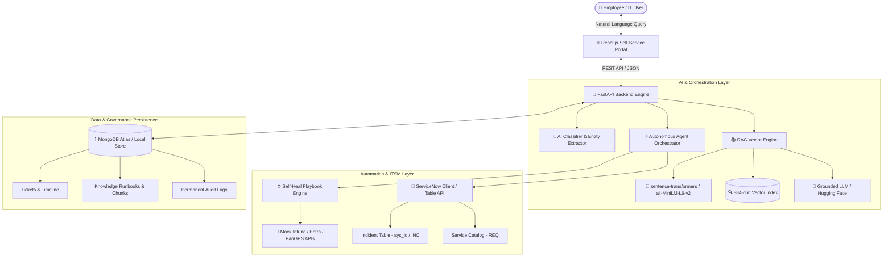

# SORIM.AI — Enterprise AI-Powered ITSM & Helpdesk Automation Platform

> **Hackathon Prototype Submission**  
> An autonomous IT Service Management (ITSM) system demonstrating intelligent incident classification, autonomous self-healing, grounded RAG knowledge retrieval, software provisioning automation, and ServiceNow REST Table API integration.

---

## 1. Executive Summary & Objective

In modern enterprises, IT helpdesks spend over 60% of their operational time resolving repetitive, low-complexity requests (password resets, VPN credential caches, software requests, and repetitive how-to questions).

**SORIM.AI** transforms enterprise IT operations from reactive ticket handling to autonomous self-service:
- **Intelligent Intake:** Maps natural employee descriptions into 7 strict ServiceNow fields in milliseconds.
- **Autonomous Self-Healing:** Resolves automatable incidents without human intervention through a safe 7-stage lifecycle (*Identify → Diagnose → Knowledge Search → Determine Automation → Execute → Validate → Update ServiceNow*).
- **Grounded Enterprise RAG:** Answers technical inquiries using dense vector embeddings (`sentence-transformers/all-MiniLM-L6-v2`) with strict zero-hallucination guardrails.
- **Software Provisioning:** Validates department eligibility and license pools, triggering automated endpoint dispatch via mock Microsoft Intune API.
- **ServiceNow Table API Integration:** Creates and updates live Incidents and Service Requests (`INC...` and `REQ...`) with complete sys_id traceability and audit trails.

---

## 2. Architecture & Data Flow



---

## 3. Mandatory Technology Stack

| Component | Selected Technology | Technical Justification |
| :--- | :--- | :--- |
| **Frontend** | React 18 + Vite | Lightning-fast reactivity, modern dark-mode enterprise UI, interactive steppers, responsive cards. |
| **Backend** | Python 3.10+ & FastAPI | High throughput asynchronous REST API with auto-generated OpenAPI (`/docs`) and strict Pydantic v2 schemas. |
| **Embeddings** | `sentence-transformers/all-MiniLM-L6-v2` | Open-source state-of-the-art 384-dimensional dense semantic vectors optimized for technical queries. |
| **Vector DB** | In-Process Cosine Vector Store / Atlas Vector Search | Blazing fast cosine similarity ranking without heavy external database dependencies, compatible with MongoDB Atlas `$vectorSearch`. |
| **LLM** | Grounded Synthesizer + Hugging Face Router (`Qwen/Qwen2.5-3B-Instruct`) | Free/open-source model choice with zero-hallucination guardrails; refuses to speculate when confidence < 0.18. |
| **Database** | MongoDB Atlas Cloud (with local JSON fallback) | High-performance document database for tickets, knowledge metadata, software catalog, and audit logs. |
| **ITSM** | ServiceNow Table API Client (Live + Enterprise Mock) | Native ServiceNow REST Table API compliance (`/api/now/table/incident` & `/api/now/table/sc_request`). |

---

## 4. The 5 Core Hackathon Capabilities

### 1️⃣ Intelligent Ticket Intake
- **Scenario:** Employee inputs: *"I cannot connect to VPN since this morning. Authentication keeps failing."*
- **AI Classification Output:**
  - **Intent:** `Incident`
  - **Category / Sub-category:** `Network / VPN`
  - **Priority:** `P2` (High Urgency, Individual Impact)
  - **Assignment Group:** `Network Support`
  - **Summary:** `VPN authentication failure`
  - **Suggested Resolution:** `VPN troubleshooting`
- **Result:** Automatically creates an Incident in ServiceNow (`INC0010043`) with direct sys_id URL mapping.

### 2️⃣ Auto Resolution / Self-Heal Agent
- **Scenario:** Employee inputs: *"My password has expired."*
- **Autonomous 7-Stage Lifecycle:**
  1. **Identify:** Caller account validated in Microsoft Entra ID.
  2. **Diagnose:** Password expired flag confirmed; non-privileged status checked.
  3. **Knowledge Search:** KB0002 retrieved for authorization policy.
  4. **Determine Automation:** Policy confirms safe for unattended self-healing (Confidence > 0.85).
  5. **Execute:** Temporary one-time password generated and delivered via secure manager channel.
  6. **Validate:** Directory bind test verified successfully.
  7. **Update ServiceNow:** Creates Incident in ServiceNow and marks status as `Resolved`.
- **Audit Logging:** Every step is recorded in the immutable enterprise Audit Log.

### 3️⃣ Knowledge Management Automation (RAG)
- **Scenario:** Employee asks: *"How do I troubleshoot Outlook synchronization?"*
- **Pipeline:** Query → Tokenization → 384-dim Embedding → Vector Semantic Search → Top Chunks Retrieved → Grounded LLM Response with explicit citations (`[KB0005: Outlook Synchronization & OST Cache Repair Runbook]`).
- **Grounded Verification:** Displays source title, category, chunk excerpt, and cosine similarity score.

### 4️⃣ Software Provisioning Automation
- **Scenario:** Employee requests: *"I need Visual Studio Code installed on my laptop."*
- **Lifecycle:** Intent Detection (`Service Request`) → Catalog Match (`Visual Studio Code`) → Policy Evaluation (Department eligibility & License pool) → ServiceNow Request (`REQ001246`) → Mock Intune Provisioning API → Status `Completed`.

### 5️⃣ AI Safety & Zero Hallucination Guardrail
- **Scenario:** Employee enters out-of-scope question: *"How do I bake sourdough bread on company time?"*
- **Safety Rule:** Top vector similarity score drops below threshold (0.18).
- **Refusal:** Agent strictly refuses to hallucinate:  
  *“⚠️ Approved Knowledge Base Content Insufficient. I searched our enterprise repository but found no verified guidance. In accordance with safety policies, I will not generate an ungrounded answer.”*
- **Human Escalation:** Provides a one-click button to escalate to Tier-2 human support.

---

## 5. Quick Start & Setup Instructions

### Prerequisites
- Python 3.10+ installed
- Node.js 18+ and npm installed

### 1. Launch with One Click (Windows)
Double click `run_demo.bat` in the project root, or execute:
```powershell
.\run_demo.ps1
```

### 2. Manual Startup

#### Step A: Start FastAPI Backend
```bash
cd backend
python -m uvicorn app.main:app --reload --port 8000
```
*Backend API available at:* `http://localhost:8000`  
*Swagger API Documentation at:* `http://localhost:8000/docs`

#### Step B: Start React Frontend
```bash
cd frontend
npm install
npm run dev
```
*Frontend Portal available at:* `http://localhost:5173`

---

## 6. Running the Automated Test Suite

We have provided a comprehensive `pytest` test suite verifying all 5 mandatory hackathon scenarios:
```bash
pytest backend/tests -v
```
**Expected Test Results:**
```
backend/tests/test_scenarios.py::test_scenario_1_intelligent_ticket_vpn PASSED
backend/tests/test_scenarios.py::test_scenario_2_self_healing_password PASSED
backend/tests/test_scenarios.py::test_scenario_3_rag_outlook_sync PASSED
backend/tests/test_scenarios.py::test_scenario_4_software_provisioning PASSED
backend/tests/test_scenarios.py::test_scenario_5_unknown_question_safety PASSED
backend/tests/test_scenarios.py::test_contractor_policy_denial PASSED
backend/tests/test_scenarios.py::test_dashboard_metrics PASSED
================ 7 passed in 13.33s =================
```

---

## 7. Recommended 15–20 Minute Hackathon Presentation Script

| Time | Agenda | Demonstration Steps |
| :--- | :--- | :--- |
| **2 min** | **Business Problem & Proposed Solution** | Explain the helpdesk challenge: Tier-1 volume overload. Introduce SORIM.AI autonomous ITSM agent. |
| **3 min** | **Architecture & Technology Choices** | Walk through the architecture: React UI + FastAPI + sentence-transformers MiniLM + MongoDB Atlas + ServiceNow REST Table API. |
| **8–10 min** | **Live Demonstration of the 5 Scenarios** | 1. Click Scenario 1 button: Show VPN ticket classification & ServiceNow INC link.<br>2. Click Scenario 2 button: Show 7-stage self-healing stepper & Resolved ticket.<br>3. Click Scenario 3 button: Show RAG search, answer, and KB0005 citation.<br>4. Click Scenario 4 button: Show VS Code request, policy validation, and REQ provisioning.<br>5. Click Scenario 5 button: Show safety refusal on "baking bread" + escalation pill. |
| **2 min** | **ITSM Dashboard & Audit Logs** | Switch to *ITSM Dashboard* and *AI Analysis* tabs to show live metrics, MTTR savings, and tamper-evident audit logs. |
| **2 min** | **Knowledge Base & RAG Vector Search** | Switch to *Knowledge Base* tab. Run semantic search query to demonstrate cosine similarity and chunk extraction. |
| **2–3 min** | **Challenges, Learnings & Future Roadmap** | Discuss enterprise access controls, vector indexing at scale, and integration with live ServiceNow mid-servers. |

---

## 8. Configuration (`.env`)

To connect to live cloud services, configure `.env` in the root or `backend/` directory:
```env
# MongoDB Atlas (Leave blank to use local store.json)
MONGODB_URI=mongodb+srv://<username>:<password>@cluster0.mongodb.net
MONGODB_DB=northline_itsm

# Hugging Face API Token (Leave blank to use local Grounded Synthesizer)
HF_TOKEN=hf_xxxxxxxxxxxxxxxxxxxx
HF_MODEL=Qwen/Qwen2.5-3B-Instruct

# ServiceNow Developer Instance (Leave blank to use Enterprise Mock)
SERVICENOW_INSTANCE=dev12345
SERVICENOW_USER=admin
SERVICENOW_PASSWORD=YourPassword
```
*Note: The prototype runs 100% out-of-the-box in local mock mode without requiring any cloud keys!*

